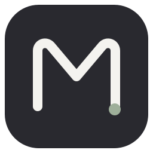
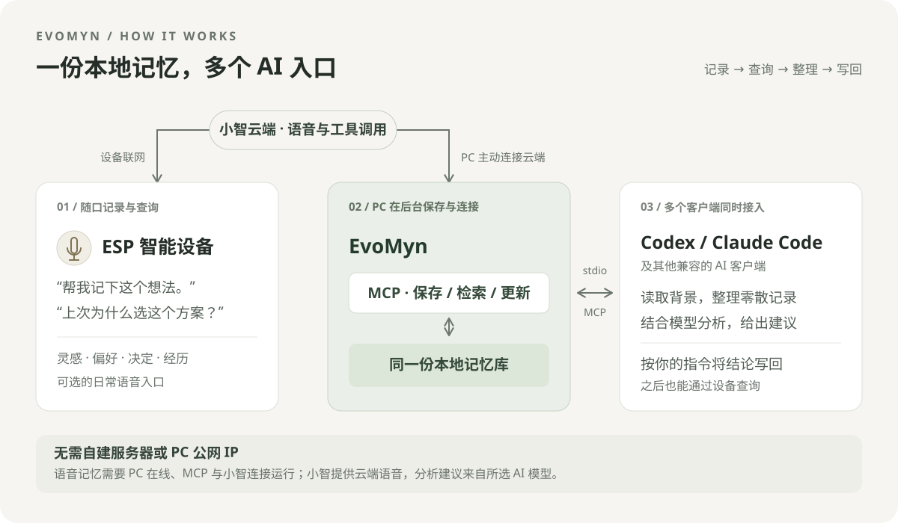
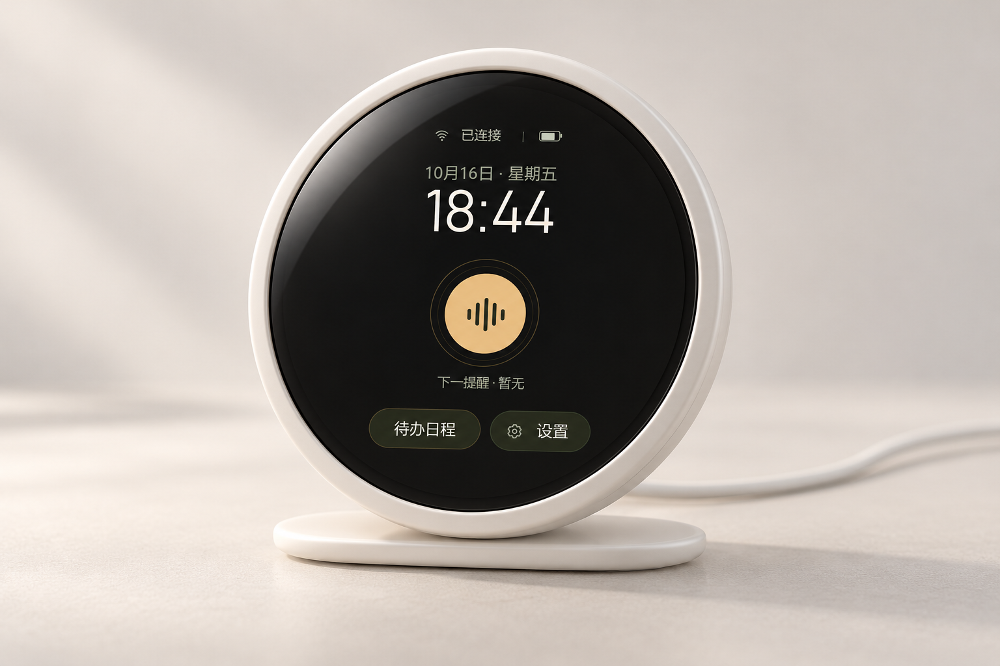
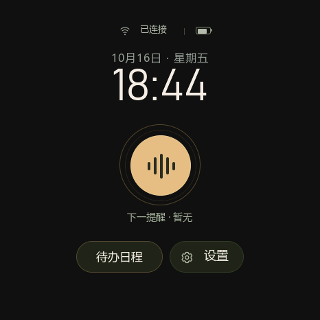
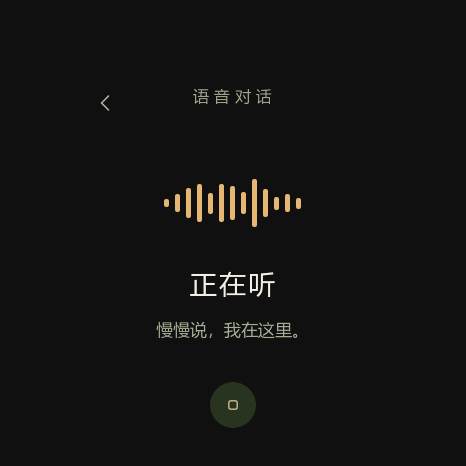
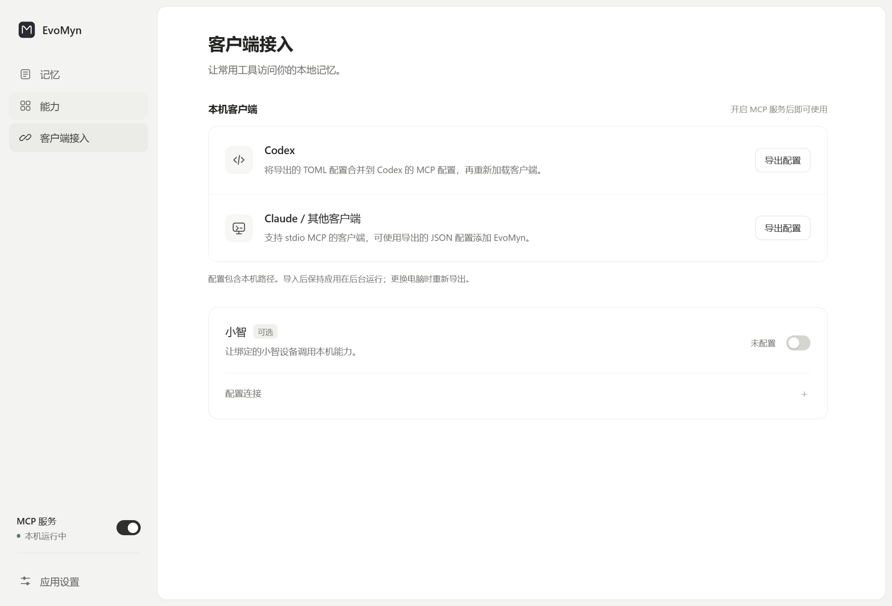
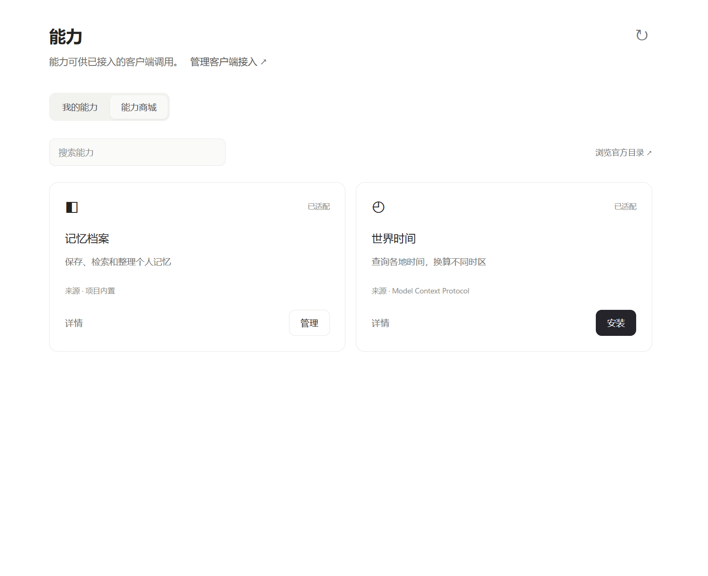
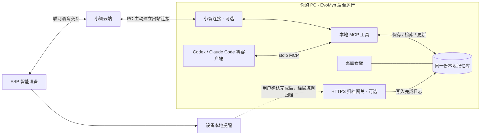

<div align="center">



# EvoMyn

**让 AI 持续了解你，参与每一天。**

EvoMyn 是一个面向个人 AI 化的开源项目。<br />
从日常记录和长期记忆出发，让 AI 帮你回顾经历、维系关系、看见成长，并将想做的事落实为提醒与行动。

本地记忆 · 多 AI 接入 · ESP 智能设备

[下载 Windows 应用](https://github.com/clover-Saber/EvoMyn/releases/latest) · [ESP 智能设备](#esp-智能设备让交互走到桌面上) · [快速开始](#快速开始) · [源码与开发](#源码与开发)

Windows 桌面应用 · MCP 服务 · ESP32-S3 固件 · MIT 开源

</div>

---

## 项目特色

- **ESP 智能设备，让记录随口发生。** 通过语音记下每天做过的事、认识的人，需要时直接问回来；触屏查看和管理设备提醒。
- **PC 本地部署，无需另租服务器。** 记忆库和 MCP 运行在自己的电脑上，无需公网 IP；设备语音通过小智云端接入，访问记忆时需保持 PC 服务在线。
- **一份记忆，多个 AI 共同使用。** Codex、Claude Code 等兼容客户端可以同时接入，读取、整理和更新同一份记忆，让不同模型都能用上你积累的背景。
- **从日常记录中看见成长。** 让接入的 AI 根据真实日志和人脉记录回顾经历、比较变化、提出建议，确认后的复盘还能写回，成为后续理解你的背景。
- **提醒在设备执行，完成后按需留档。** 已保存的提醒在设备有电、时钟有效时可独立运行；用户确认完成后，可通过选配网关归档到 PC 日志，暂时断开时保留待归档事件。
- **桌面应用统一管理，开源可扩展。** 看板、记忆分类、MCP 开关、客户端接入和能力包集中在一个应用里，支持托盘常驻与应用内更新；桌面端、服务端和设备固件源码均可查阅与适配。

## 个人 AI 化，从理解你的生活开始

你做过的事、认识的人、形成的习惯、正在努力的目标，共同构成了你的生活。让 AI 持续帮得上忙，需要让这些背景在一次次对话之后留下来，并在需要的时候被找到、理解和使用。

**EvoMyn 希望让个人 AI 化成为一种日常使用方式：经历能够积累，理解能够延续，建议能够变成行动。** 你决定留下什么、接入哪个 AI，以及哪些建议值得采纳；随着记录积累，AI 可以依据更多真实背景帮助你回忆、判断和规划。

今天，这个方向落在一条具体的链路上：用 ESP 智能设备随口记录和查询，PC 在后台保存本地记忆并提供 MCP，Codex、Claude Code 等客户端同时接入，按你的指令整理记录、回顾变化、给出建议。选定的结论可以写回记忆，待办可以通过设备工具设为提醒，确认完成的事项也能按需归档。

## 一份属于你的记忆，连接日常与 AI

<p align="center">
  
</p>

| 入口 | 负责什么 | 你可以怎么用 |
| --- | --- | --- |
| **ESP 智能设备** | 日常语音入口 | 记录每天做过的事、认识的人，查询过往经历，设置设备提醒。 |
| **PC 上的 EvoMyn** | 本地记忆库与 MCP 服务 | 后台运行，保存记录，在看板里查看分类、关联和历史，管理客户端接入。 |
| **Codex / Claude Code 等** | 整理与深入分析 | 多个客户端共用同一份库，按你的指令整理日常记录、回顾变化，结合各自模型给出建议。 |

**无需自建服务器，也无需给 PC 配置公网 IP。** PC 主动连接小智云端，让已绑定的设备调用记忆工具；本机 AI 客户端直接通过 MCP 接入。使用设备记录、查询 PC 记忆时，PC 需要开机、EvoMyn 的 MCP 与小智连接需要运行，设备和 PC 均需联网。这里的“本地”指记忆存储与 MCP 运行位置，设备语音仍使用小智云端服务。

硬件是可选入口：只安装 Windows 应用、接入常用 AI 客户端，也能使用记忆库。EvoMyn 提供记忆和工具，分析与建议来自你选择的客户端及模型。多个入口共享已保存的背景，各自的对话和任务仍由你发起、管理。

## 从每天用得上的事情开始

下面的对话可以作为使用起点。记忆的保存、查询与整理由已接入的 AI 调用 MCP 工具完成；提醒通过设备侧工具设置。

### 场景一：随口说几句，记下今天做过的事

> 「帮我记一下今天的事：上午独立完成了汇报，下午跑了三公里，晚上读了二十页书。汇报时还有点紧张，但这次没有照着稿子念。」

不用等到有空整理长篇日记，也能留下当天具体的经历。以后问设备：「我上次汇报是什么情况？」「最近都做了些什么？」就可以检索保存过的记录。

### 场景二：记住认识的人，也记住你们的交集

> 「今天在读书会上认识了小林，他做产品设计，也喜欢徒步。我们聊了周末去郊外走走，帮我记到人脉里。」

下次想联系对方时，问设备：「我在哪里认识的小林？我们上次聊了什么？」让 AI 从保存的记录中找回背景。后续有新的接触，也可以补充到这个人的记录中。

### 场景三：回顾一段时间，看见有依据的进步

在 Codex、Claude Code 等已接入的客户端中说：

> 「查一下我这个月的日志，和上个月比一比：做成了什么、哪些事情坚持下来了、什么问题还在反复出现。请用具体记录和日期说明变化；没有足够记录的地方就说明，不要替我补经历。最后给我两条下个月可以尝试的建议。」

这时，更强模型的价值是结合日常积累，帮你看见自己容易忽略的变化。例如，从「汇报时一直看稿」到「能独立讲完」，从一次运动到逐渐规律。确认复盘后，可以让 AI 保存为月度日志，再通过设备询问「我这个月有哪些进步」。

成长回顾由你在 AI 客户端中发起，依据实际保存的记录生成。

### 场景四：记住接下来要做的事，完成后留下记录

> 「明天晚上七点提醒我去跑步。」

设备保存提醒，到点后响铃；事情完成后点击「已完成」。配置可选的归档网关后，完成事件会在能连接到 PC 时写入个人日志，成为以后回顾的依据。PC 暂时离线时，设备保留待归档事件并重试。

已保存的提醒在设备有电、时钟有效时可独立执行，不要求 PC 一直开着。语音设置提醒需要小智云端连接；让 AI 保存一份计划不会自动创建闹钟，需要明确设置设备提醒。

这样，日常记录帮助你回看，提醒帮助你行动，确认完成的事情又能留进自己的经历里。完成归档与语音记忆接入分别配置，详见[连接图](#软件与设备怎样连接)。

## ESP 智能设备：让交互走到桌面上

<p align="center">
  
</p>

<p align="center"><sub>ESP 智能设备外观概念图，参考提供的硬件外观与项目界面生成。非实物摄影；实际适配以支持板型为准。</sub></p>

### 用语音发起，用设备执行

- **语音交互**：通过小智进行对话，调用已接入的 PC 记忆能力，也可以通过设备侧工具创建和管理提醒。
- **设备本地提醒**：事项保存在设备上。联网校时后，已保存的提醒在断网或 PC 未运行时仍可执行，无需电脑持续调度。
- **触屏管理**：查看待办和详情，确认完成、取消事项或稍后提醒；停止铃声与确认完成分开处理。
- **完成后再归档**：只有用户确认完成才产生归档事件；PC 暂时不可用时保留待归档事件，连接恢复后重试，避免重复写入日志。
- **设备设置与更新**：提供 Wi-Fi、智能体、音量、亮度设置，以及可配置的固件 OTA 更新流程。

<p align="center">
  
  &nbsp;&nbsp;
  
</p>

<p align="center"><sub>项目原生 LVGL 界面渲染预览：设备首页与语音页，非实物拍摄。</sub></p>

语音创建和云端对话需要连接小智服务；离线能力指已保存提醒的本地执行。日志归档需要启用 PC 局域网 HTTPS 网关，PC 记忆检索也需要对应服务在线。归档网关与设备 OTA 默认关闭，由所有者配置。

### 当前支持什么硬件

当前定制固件面向 **ESP32-S3 + 1.75 英寸触控 AMOLED**，板型为 `round-voice-175c`，使用 466 × 466 屏幕、32 MB Flash 和 8 MB PSRAM。板型名称是源码中的技术标识，其他 ESP 设备需要对应适配。

设备固件与桌面应用分别维护，桌面应用升级不会自动烧录设备。硬件使用者需按[板型说明](xiaozhi-firmware/main/boards/round-voice-175c/README.md)和[公开固件构建指南](docs/round-open-source.md)准备工具链、开放字体与设备配置；完整开放字体构建及实机验证仍需完成。**软件部分可独立使用，硬件联动是可选的特色能力。**

## 电脑上的记忆中心

在同一个 Windows 应用里浏览记忆、管理能力和连接客户端。关闭窗口后留在托盘，PC 继续提供 MCP 服务；随时可以打开看板检查 AI 保存了什么。

<p align="center">
  
</p>

## EvoMyn 能为你做什么

| 能力 | 日常怎么用 |
| --- | --- |
| **ESP 智能设备联动** | 语音记录和查询 PC 记忆；设备本地管理提醒，把确认完成的事件按需归档为日志。 |
| **跨客户端的个人记忆** | 在同一台电脑上，让已接入的 Codex、Claude Code 等客户端访问同一份档案，减少反复交代背景。 |
| **可整理的记忆库** | 默认提供人脉、日志、个人、事件、资料五类；也可以新增分类、改名和调整顺序，按自己的方式组织信息。 |
| **检索、关联与历史** | 通过 MCP 按语义查找记忆，查看记录之间的关联和历史版本；看板提供浏览、搜索和筛选。 |
| **按功能管理 MCP** | 按能力包开启或关闭工具。商城标注来源，提供已经完成适配的能力，世界时间等扩展可按需安装。 |
| **桌面与后台一体** | 在同一个应用里使用看板、管理接入和控制 MCP。关闭窗口后常驻托盘，退出应用时停止后台服务。 |
| **应用内更新** | 内置 GitHub Releases 更新源，在设置中检查、下载并重启安装；升级默认保留本地数据。 |

<details>
<summary>看看能力管理界面</summary>

<p align="center">
  
</p>

当前商城提供已适配的目录条目，并非任意 MCP 都能直接安装。ESP 智能设备内置的计划提醒在设备上管理，不放入 PC 能力列表。

</details>

## 快速开始

### 1. 安装并打开应用

在 [Releases](https://github.com/clover-Saber/EvoMyn/releases/latest) 下载 `EvoMyn-Setup-<版本>-x64.exe`，安装后打开 **EvoMyn**。

安装包包含运行所需的 Python 和依赖，无需另装 Python、Node.js 或 Docker。首次使用语义检索可能需要联网下载模型；通过商城安装可选扩展时也需要联网。

> 本文和界面截图介绍当前主分支，已发布安装包的功能以对应 Release 的说明为准。目前提供 Windows x64 安装包。

### 2. 开启 MCP，接入常用客户端

打开左下角 **MCP 服务**开关，再进入 **客户端接入**：

| 客户端 | 接入方式 |
| --- | --- |
| Codex | 导出 TOML，将条目合并到客户端的 MCP 配置，再重新加载客户端。 |
| Claude Code / 其他兼容客户端 | 导出 JSON，按客户端的配置方式添加 EvoMyn；客户端需支持 stdio MCP。 |
| 小智 / ESP 智能设备（可选） | 展开连接配置，按引导获取并填写小智 MCP 接入点，再开启小智连接，让绑定设备通过小智调用 PC 能力。 |

配置由应用按本机安装位置生成，无需手写路径。应用不会自动覆盖客户端已有配置；更换电脑后请重新导出。连接后先让客户端查看可用工具，再尝试保存第一条记忆。

**不接小智也能完整使用本地记忆 MCP。** 本地客户端使用 stdio，无需填写公网 MCP 地址。小智通过 PC 主动建立的出站连接使用能力，需要相应的云端服务和网络，但不要求给 PC 配置公网 IP。

体验硬件时，设备本地提醒通过设备侧工具管理；连接 PC 记忆、完成日志归档和固件 OTA 是各自配置的功能。填写小智 MCP 接入点不会自动完成设备烧录或启用归档网关。

### 3. 让它留在后台

关闭窗口后，EvoMyn 继续在托盘运行，已接入的客户端可以继续使用 MCP。需要暂时停用时，关闭 **MCP 服务**开关；需要结束后台时，从托盘退出应用。

MCP 总开关控制服务执行，小智开关控制可选的云端连接。关闭小智连接仍可使用本机 MCP；关闭 MCP 后，客户端不能继续调用工具，看板仍可浏览。

后续更新可在 **应用设置 → 应用更新**中完成，无需每次到仓库寻找安装包。更早版本的更新接入方法见[桌面应用说明](desktop/README.md#应用内更新)。

## 记忆放在哪里

记忆原文、分类、关联和历史版本保存在本地 SQLite 数据库中。语义索引失败时，已持久保存的原文仍然保留，可稍后重试索引。

Windows 桌面版的默认位置：

```text
%LOCALAPPDATA%\PersonalMemory\service\
├── state\data\mnemosyne.db   记忆数据库
├── state\backups\            手动生成的数据库快照
└── state\resources\          附件资源
```

在应用设置中点击「打开数据目录」可以找到数据库。沿用 `PersonalMemory` 目录名是为了兼容已有安装，无需手动改名。

- **备份由你掌握。** 让接入的客户端调用 `archive_backup`，即可生成包含记忆、分类和历史的一致性数据库快照；附件需另行保留。当前主分支不提供个人记忆的 GitHub 云备份配置，也不会默认上传记忆用于备份。操作步骤见[备份与恢复](server/personal-memory/BACKUP.md)。
- **更新与数据分开。** 应用升级默认保留记录与配置。GitHub 用于分发应用代码和更新包；源码仓库不包含你的个人数据库。
- **连接边界清楚。** 记忆保存在本机，但当你让某个 AI 客户端检索记忆时，返回的内容会进入该客户端的处理流程。连接云端客户端或小智时，相关内容还受对应服务的数据规则约束。

## 软件与设备，怎样连接



实线的记忆访问由 MCP 完成：设备经小智调用，PC 客户端在本机调用，使用的是同一份记忆库。PC 主动连出，因此这条设备语音记忆路径不要求设备与 PC 在同一局域网，也不需要部署额外的公网中转服务器。多个客户端共享的是保存下来的记录，各自的完整聊天上下文不会自动互通。

虚线是独立的设备完成归档路径，需要设备能够访问已配置的 PC 局域网 HTTPS 网关。设备提醒本身在设备上执行；网关和固件 OTA 默认关闭，按需配置。

## 常见问题

**必须买硬件、绑定小智或租服务器吗？**

不需要。Windows 应用和本机 MCP 可以独立使用。ESP 智能设备是可选的交互入口，当前语音交互基于小智服务。

**提醒时必须让 PC 开着吗？**

设备已保存的提醒由设备执行，无需 PC 在线；需保持设备有电、时钟有效。语音设置依赖云端连接，访问 PC 记忆或向 PC 归档则需要相应服务在线。

**PC 关机后，设备还能记录和查询这份记忆吗？**

不能访问 PC 上的记忆服务。设备记忆调用需要 PC 在线且 MCP、小智连接运行；设备本地提醒和待归档完成事件是另一套机制，不能视为通用语音记忆的离线缓存。

**接入 Codex 后，会自动帮我整理和给建议吗？**

需要你在客户端发起任务，并允许它调用相应记忆工具。EvoMyn 不内置独立的聊天模型，也不会自行定期整理记忆；建议质量取决于所选模型、检索到的信息和你的指令。

**所有 ESP32 设备都能直接刷入吗？**

当前定制固件适配上述指定板型；其他屏幕、音频和电源方案需要对应驱动与界面适配，不能按通用固件直接刷入。

**安装应用就会自动记住所有对话吗？**

不会。需要由接入的客户端调用工具保存或检索；模型是否主动调用，也取决于客户端配置和你的指令。

**可以在看板里直接改记忆正文吗？**

当前看板用于浏览、搜索、查看关联和历史，并支持分类管理。记忆正文通过 MCP 保存和更新。

**几台电脑会自动同步吗？**

当前主要面向单机使用。同机客户端可以共享记忆，跨电脑不会自动同步，需要自行管理备份和迁移。

**Windows 提示未识别发布者怎么办？**

当前安装包尚未配置 Windows 发布者证书。请从本仓库 Releases 获取安装包，并核对发布说明；应用内更新另有签名及文件完整性校验。两种签名机制的说明见[桌面文档](desktop/README.md#应用内更新)。

## 源码与开发

欢迎一起适配更多 ESP 智能设备、完善语音与提醒交互、改进记忆体验，或接入新的 MCP 能力。提交问题时，请附上应用版本、硬件板型（如涉及）、复现步骤和经过脱敏的日志；请勿上传个人数据库或接入凭证。

| 入口 | 内容 |
| --- | --- |
| [desktop/](desktop/README.md) | Windows 应用、托盘、服务开关、签名更新与安装包构建 |
| [server/personal-memory/](server/personal-memory/README.md) | 记忆服务、MCP、看板及源码启动器 |
| [xiaozhi-firmware/](xiaozhi-firmware/README.md) | ESP 智能设备固件、板型适配、本地提醒与设备更新 |
| [preview/](preview/README.md) · [assets/](assets/README.md) | 智能设备屏幕交互预览与图标矢量源 |
| [架构](docs/architecture.md) · [开发指南](docs/development.md) | 模块边界、测试与干净源码导出 |
| [贡献指南](CONTRIBUTING.md) · [安全反馈](SECURITY.md) | 参与方式和问题报告 |

<details>
<summary>不安装桌面应用，直接从源码启动</summary>

准备 Windows、Git，以及 **Python 3.11（推荐）或 uv**；首次启动需要联网下载依赖。

```powershell
git clone https://github.com/clover-Saber/EvoMyn.git
cd EvoMyn
.\Start.cmd
```

启动器准备本地运行副本并打开看板。随后运行 `Configure.cmd` 导出客户端配置，使用 `Stop.cmd` 停止启动器管理的服务。也提供对应的中文命令入口。

运行副本位于忽略的 `artifacts/local-memory-mcp/`，数据库为其中的 `state/data/mnemosyne.db`。运行副本首次创建、后续复用，拉取新源码不会直接覆盖已有运行环境和数据，维护方法见[开发指南](docs/development.md)。

源码启动方式与桌面安装方式使用不同的数据目录。客户端自行启动的源码 stdio 进程不受桌面开关控制；改用桌面版时，请停用旧入口，并使用桌面版重新导出的配置。

</details>

## 致谢与许可

EvoMyn 建立在优秀开源项目之上：智能设备固件基于 **xiaozhi-esp32**，记忆引擎使用 **Mnemosyne**，看板基于 **wysie/mnemosyne-dashboard** 适配；桌面端使用 Electron，工具接入遵循 MCP。

项目自身新增代码采用 [MIT 许可](LICENSE)。上游代码、依赖、模型和字体保留各自的许可与来源，完整清单见[第三方声明](THIRD_PARTY_NOTICES.md)。

如果 EvoMyn 对你有帮助，欢迎 Star、分享使用方式，或者带着具体场景来提一个 Issue。
