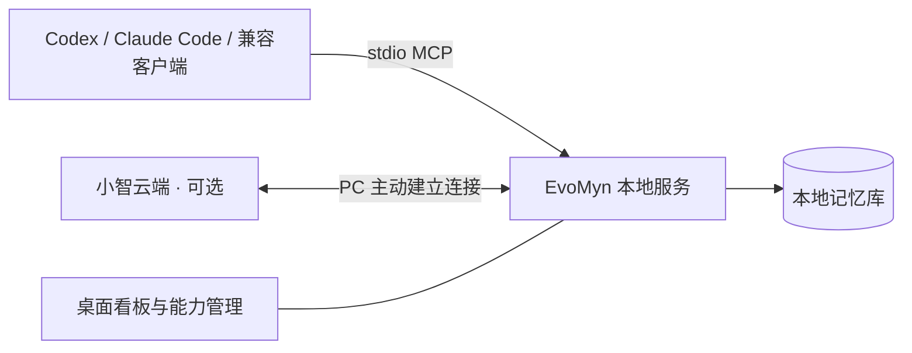

<div align="center">


# EvoMyn

**让 AI 记住你，也让记忆留在你手里。**

一个运行在自己电脑上的个人记忆中心。通过 MCP，让 Codex、Claude Code 和小智等客户端，共同使用你选择保存的记忆。

Local-first personal memory for your AI tools, connected through MCP.

[下载 Windows 应用](https://github.com/clover-Saber/EvoMyn/releases/latest) · [快速开始](#快速开始) · [源码与开发](#源码与开发) · [反馈与建议](https://github.com/clover-Saber/EvoMyn/issues)

Windows x64 · 本地存储 · MCP · MIT 开源

</div>

---

## 少一点重复介绍，多一点持续了解

你的习惯、项目背景、重要的人和做过的决定，往往散落在不同的对话里。换一个工具、开启一次新对话，又要从头解释。

EvoMyn 把这些值得保留的信息整理到一份本地记忆库。你可以让接入的 AI 保存、更新和检索记忆，也可以随时打开看板，查看记录、分类和修改历史。使用哪个 AI，由你选择；哪些信息值得记住，也由你决定。

**装好桌面应用，开启 MCP，接入你常用的客户端，就可以开始。无需购买圆盘，也无需部署云服务器。**

<p align="center">
  
</p>

## EvoMyn 能为你做什么

| 能力 | 日常怎么用 |
| --- | --- |
| **跨客户端的个人记忆** | 在同一台电脑上，让已接入的 Codex、Claude Code 等客户端访问同一份档案，减少反复交代背景。 |
| **可整理的记忆库** | 默认提供人脉、日志、个人、事件、资料五类；也可以新增分类、改名和调整顺序，按自己的方式组织信息。 |
| **检索、关联与历史** | 通过 MCP 按语义查找记忆，查看记录之间的关联和历史版本；看板提供浏览、搜索和筛选。 |
| **按功能管理 MCP** | 按能力包开启或关闭工具。商城标注来源，提供已经完成适配的能力，世界时间等扩展可按需安装。 |
| **桌面与后台一体** | 在同一个应用里使用看板、管理接入和控制 MCP。关闭窗口后常驻托盘，退出应用时停止后台服务。 |
| **应用内更新** | 内置 GitHub Releases 更新源，在设置中检查、下载并重启安装；升级默认保留本地数据。 |

### 从这些小事开始

接入客户端后，可以尝试这样说：

> 记住我的写作偏好：先说结论，少用套话，保留必要的技术细节。

> 把今天讨论的项目决定整理成日志，记录我们为什么选择这个方案。

> 查一下我之前保存的项目背景，再帮我准备这次讨论的提纲。

这些是交互示例，实际保存或检索需要客户端调用 EvoMyn 的 MCP 工具。EvoMyn 不会自动读取其他应用的全部聊天记录。

<details>
<summary>看看能力管理界面</summary>

<p align="center">
  
</p>

当前商城提供已适配的目录条目，并非任意 MCP 都能直接安装。圆盘内置的计划提醒在设备上管理，不放入 PC 能力列表。

</details>

## 快速开始

### 1. 安装并打开应用

在 [Releases](https://github.com/clover-Saber/EvoMyn/releases/latest) 下载 `EvoMyn-Setup-<版本>-x64.exe`，安装后打开 **EvoMyn**。

安装包包含运行所需的 Python 和依赖，无需另装 Python、Node.js 或 Docker。首次使用语义检索可能需要联网下载模型；通过商城安装可选扩展时也需要联网。

> 本文和界面截图介绍当前主分支，已发布安装包的功能以对应 Release 的说明为准。目前提供 Windows x64 安装包。

### 2. 开启 MCP，接入常用客户端

打开左下角 **MCP 服务**开关，再进入 **客户端接入**：

| 客户端 | 接入方式 |
| --- | --- |
| Codex | 导出 TOML，将条目合并到客户端的 MCP 配置，再重新加载客户端。 |
| Claude Code / 其他兼容客户端 | 导出 JSON，按客户端的配置方式添加 EvoMyn；客户端需支持 stdio MCP。 |
| 小智（可选） | 展开连接配置，按应用内引导获取并填写小智 MCP 接入点，再单独开启小智连接。 |

配置由应用按本机安装位置生成，无需手写路径。应用不会自动覆盖客户端已有配置；更换电脑后请重新导出。连接后先让客户端查看可用工具，再尝试保存第一条记忆。

**不接小智也能完整使用本地记忆 MCP。** 本地客户端使用 stdio，无需填写公网 MCP 地址。小智通过 PC 主动建立的出站连接使用能力，需要相应的云端服务和网络，但不要求给 PC 配置公网 IP。

### 3. 让它留在后台

关闭窗口后，EvoMyn 继续在托盘运行，已接入的客户端可以继续使用 MCP。需要暂时停用时，关闭 **MCP 服务**开关；需要结束后台时，从托盘退出应用。

MCP 总开关控制服务执行，小智开关控制可选的云端连接。关闭小智连接仍可使用本机 MCP；关闭 MCP 后，客户端不能继续调用工具，看板仍可浏览。

后续更新可在 **应用设置 → 应用更新**中完成，无需每次到仓库寻找安装包。更早版本的更新接入方法见[桌面应用说明](desktop/README.md#应用内更新)。

## 记忆放在哪里

记忆原文、分类、关联和历史版本保存在本地 SQLite 数据库中。语义索引失败时，已持久保存的原文仍然保留，可稍后重试索引。

Windows 桌面版的默认位置：

```text
%LOCALAPPDATA%\PersonalMemory\service\
├── state\data\mnemosyne.db   记忆数据库
├── state\backups\            手动生成的数据库快照
└── state\resources\          附件资源
```

在应用设置中点击「打开数据目录」可以找到数据库。沿用 `PersonalMemory` 目录名是为了兼容已有安装，无需手动改名。

- **备份由你掌握。** 让接入的客户端调用 `archive_backup`，即可生成包含记忆、分类和历史的一致性数据库快照；附件需另行保留。当前主分支不提供个人记忆的 GitHub 云备份配置，也不会默认上传记忆用于备份。操作步骤见[备份与恢复](server/personal-memory/BACKUP.md)。
- **更新与数据分开。** 应用升级默认保留记录与配置。GitHub 用于分发应用代码和更新包；源码仓库不包含你的个人数据库。
- **连接边界清楚。** 记忆保存在本机，但当你让某个 AI 客户端检索记忆时，返回的内容会进入该客户端的处理流程。连接云端客户端或小智时，相关内容还受对应服务的数据规则约束。

## 一份记忆，多种入口



MCP 负责让 AI 使用工具，桌面应用负责运行与管理服务，看板负责让你看清记忆。EvoMyn 不内置独立的 AI 聊天模型，你可以继续使用自己熟悉的客户端。

### 可选：连接语音圆盘

仓库还包含基于小智的 **ESP32-S3 圆盘固件**（`round-voice-175c`），适合希望进一步探索语音交互和桌面硬件的开发者。

- 提醒保存在设备上，由圆盘执行，无需 PC 持续在线调度。
- 用户确认完成后，可通过选配的局域网 HTTPS 网关，将完成事件归档到 PC 记忆库。
- 提供固件 OTA 扩展；网关和 OTA 默认关闭，需要自行配置证书、设备身份与更新地址。

圆盘是独立的可选模块，桌面应用更新不会自动烧录固件。公开固件需准备适配的开放字体和 ESP-IDF 环境，完整开放字体构建及实机验证仍需完成，详见[固件开源与构建说明](docs/round-open-source.md)。

## 常见问题

**必须买硬件、绑定小智或租服务器吗？**

不需要。Windows 应用和本机 MCP 可以独立使用，小智与圆盘均为可选入口。

**安装应用就会自动记住所有对话吗？**

不会。需要由接入的客户端调用工具保存或检索；模型是否主动调用，也取决于客户端配置和你的指令。

**可以在看板里直接改记忆正文吗？**

当前看板用于浏览、搜索、查看关联和历史，并支持分类管理。记忆正文通过 MCP 保存和更新。

**几台电脑会自动同步吗？**

当前主要面向单机使用。同机客户端可以共享记忆，跨电脑不会自动同步，需要自行管理备份和迁移。

**Windows 提示未识别发布者怎么办？**

当前安装包尚未配置 Windows 发布者证书。请从本仓库 Releases 获取安装包，并核对发布说明；应用内更新另有签名及文件完整性校验。两种签名机制的说明见[桌面文档](desktop/README.md#应用内更新)。

## 源码与开发

欢迎一起改进记忆体验、适配新的 MCP 能力、完善客户端接入，以及探索圆盘交互。提交问题时，请附上应用版本、复现步骤和经过脱敏的日志；请勿上传个人数据库或接入凭证。

| 入口 | 内容 |
| --- | --- |
| [desktop/](desktop/README.md) | Windows 应用、托盘、服务开关、签名更新与安装包构建 |
| [server/personal-memory/](server/personal-memory/README.md) | 记忆服务、MCP、看板及源码启动器 |
| [xiaozhi-firmware/](xiaozhi-firmware/README.md) | 可选小智固件与圆盘板型 |
| [preview/](preview/README.md) · [assets/](assets/README.md) | 圆屏交互预览与图标矢量源 |
| [架构](docs/architecture.md) · [开发指南](docs/development.md) | 模块边界、测试与干净源码导出 |
| [贡献指南](CONTRIBUTING.md) · [安全反馈](SECURITY.md) | 参与方式和问题报告 |

<details>
<summary>不安装桌面应用，直接从源码启动</summary>

准备 Windows、Git，以及 **Python 3.11（推荐）或 uv**；首次启动需要联网下载依赖。

```powershell
git clone https://github.com/clover-Saber/EvoMyn.git
cd EvoMyn
.\Start.cmd
```

启动器准备本地运行副本并打开看板。随后运行 `Configure.cmd` 导出客户端配置，使用 `Stop.cmd` 停止启动器管理的服务。也提供对应的中文命令入口。

运行副本位于忽略的 `artifacts/local-memory-mcp/`，数据库为其中的 `state/data/mnemosyne.db`。运行副本首次创建、后续复用，拉取新源码不会直接覆盖已有运行环境和数据，维护方法见[开发指南](docs/development.md)。

源码启动方式与桌面安装方式使用不同的数据目录。客户端自行启动的源码 stdio 进程不受桌面开关控制；改用桌面版时，请停用旧入口，并使用桌面版重新导出的配置。

</details>

## 致谢与许可

EvoMyn 建立在优秀开源项目之上：记忆引擎使用 **Mnemosyne**，看板基于 **wysie/mnemosyne-dashboard** 适配，可选固件基于 **xiaozhi-esp32**；桌面端使用 Electron，工具接入遵循 MCP。

项目自身新增代码采用 [MIT 许可](LICENSE)。上游代码、依赖、模型和字体保留各自的许可与来源，完整清单见[第三方声明](THIRD_PARTY_NOTICES.md)。

如果 EvoMyn 对你有帮助，欢迎 Star、分享使用方式，或者带着具体场景来提一个 Issue。
