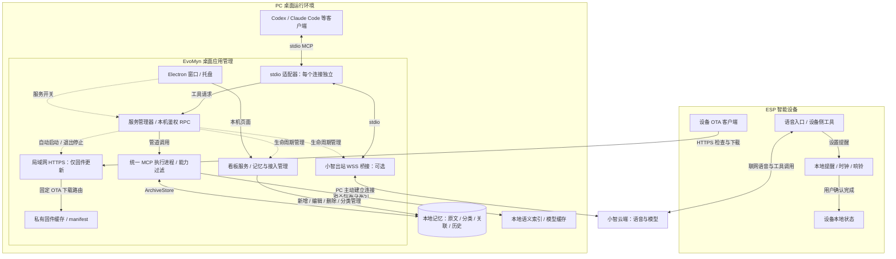
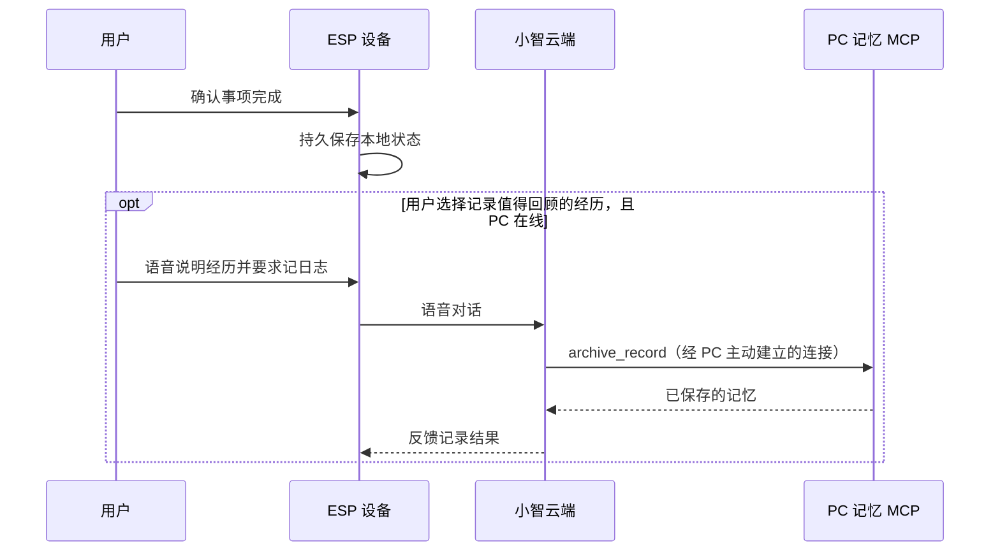

# 架构与数据边界

本文描述当前实现，以 Windows 桌面安装为主要入口；提醒仅在 ESP 设备本地执行，桌面应用可自动托管已配对设备的固件 OTA。EvoMyn 负责本地记忆、MCP 工具和设备配套服务；对话模型由接入的 AI 客户端或小智云端提供。设备是可选入口，桌面应用可独立使用。

## 组件与调用关系

实线表示请求或数据流，虚线表示生命周期控制。图中的适配器代表多个独立连接；各本机客户端和小智桥接使用同一个桌面执行进程，服务管理器串行转交工具请求。“同时接入”不等于多个工具在执行进程内并行运行。

### 记忆访问的两条入口

1. **本机客户端**：客户端按导出的配置启动 `desktop/backend/client.py`，通过 stdio 使用 MCP 协议；适配器再经带会话凭证的回环 RPC 将请求交给桌面服务。适配器不能自行启动私有执行进程，因此 MCP 总开关对已连接的客户端也生效。
2. **设备语音**：设备连接小智云端，PC 的可选桥接主动建立出站 WSS 连接，将云端工具请求转给同样的 stdio 适配器。需要 MCP 与小智连接均开启、设备与 PC 均联网；这条路径无需 PC 公网 IP，也不要求设备与 PC 在同一局域网。

两条入口操作同一份本地记忆。共享的是显式保存的记录，客户端完整聊天、模型状态不会自动同步；AI 是否调用工具取决于客户端配置和用户指令。语音访问 PC 记忆没有设备端通用离线缓存。

### 本机服务与网络边界

- 桌面版看板、档案 API、能力管理和 RPC 使用动态分配的 `127.0.0.1` 端口。`desktop-session.json` 保存当前会话地址和凭证，由适配器读取，不是公开 MCP 接入地址。
- 本地客户端导出的是 stdio 配置，不是 HTTP MCP URL。源码启动器的默认看板地址 `http://127.0.0.1:18768/memory/` 不应硬编码为桌面版地址。
- 设备网关是另一个独立的 HTTPS 监听器，必须显式配置局域网地址、证书和设备身份；不经过看板反向代理，不向设备开放管理页面或任意工具执行。
- 小智接入点保存在私有配置中，不进入导出的客户端 TOML / JSON。工具检索返回的记忆会进入所选 AI 服务的处理流程；本地存储不代表云端 AI 无法看到被调用工具返回的内容。

## 服务开关与进程所有权

| 操作 | 本机 MCP / 执行进程 | 小智连接 | 看板 |
| --- | --- | --- | --- |
| 关闭窗口，保留托盘 | 保持当前状态 | 保持当前状态 | 继续运行 |
| 关闭小智连接 | 不受影响 | 停止 | 不受影响 |
| 关闭 MCP 总开关 | 禁止调用并停止执行进程 | 停止实际连接 | 继续运行 |
| 退出桌面应用 | 停止 | 停止 | 停止 |

MCP 开关控制工具执行，看板可继续浏览和管理记忆。桌面不再启动设备完成日志网关，旧版保存的同步开关也不会恢复监听；已有日志和配对文件保留。执行进程异常或交换超时会停止该实例并关闭 MCP 状态。设备本地提醒不受这些桌面开关影响。

安装包升级前会停止桌面服务，并确认登记的客户端转发进程已退出；应用重新启动后，AI 客户端需要重新连接。

## 记忆、索引与备份

`ArchiveStore` 将原始档案、历史版本、双向关联和分类保存在 SQLite。原文持久化与语义索引分离：索引失败保留已提交原文及待索引状态，可稍后重试。首次语义检索可能下载本地模型；这些模型用于记忆检索，不是内置聊天模型。

默认分类为个人、人脉、日志、资料。分类使用稳定编号，改名和排序不改写记录或历史；MCP 通过 `archive_status.categories` 获取当前编号和名称。默认分类也支持改名和排序，只有空的自定义分类可以删除。桌面和本地 dashboard 显式向 viewer 提供 ArchiveStore，开放记录增删改和所属分类调整；独立 viewer 仍保持正文只读。写入 API 要求同源 Origin、CSRF 令牌及受限 JSON 字段。更新和删除携带 revision；并发冲突返回 409，要求重新读取。

桌面保存先提交原文及历史，索引任务在后台执行。索引完成时重新核对版本，过期结果不能覆盖新记录或恢复已删记录。删除在一次事务中移除原文和历史、清理活动关联，并保留最小删除标记；设备事件仅保留原始事件摘要用于拒绝内容冲突和确认已处理的重试。删除不清除磁盘附件、已有备份或保证语义引擎物理擦除；已删记录不再通过档案检索返回。

能力开关同时限制工具发现与调用，商城只提供已适配目录。世界时间等可选扩展使用独立环境，不改变核心记忆服务的依赖。

桌面版用户数据位于 `%LOCALAPPDATA%/PersonalMemory/service/`：

| 路径 | 内容 |
| --- | --- |
| `state/data/mnemosyne.db` | 记忆原文、分类、关联及历史 |
| `state/resources/` | 附件资源 |
| `state/backups/` | 用户手动创建的数据库快照 |
| `app/.env` | 小智接入点等私有配置 |
| `device-sync.json`、`device-sync/` | 沿用已配对设备的身份与私有 TLS 凭证，仅用于 OTA；旧同步开关失效 |
| `device-updates/` | 已校验的兼容固件与 manifest，桌面升级保留；不属于公开源码或安装包 |
| `state/device-sync-status.json` | 旧版接收历史，不含事件正文 |
| `app/models/` | 本地模型缓存 |
| `logs/` | 运行日志 |

`archive_backup` 创建一致性数据库快照；附件需另行保留，不默认上传云端。更新代码与用户数据分开，应用升级默认保留记录和配置。备份恢复的停机、旧库保留与附件处理见[备份与恢复](../server/personal-memory/BACKUP.md)。

## 设备本地提醒与主动记录

默认 `PLANNER_OWNER=device`。提醒的保存、计时、响铃和完成状态由 ESP 设备负责，PC 不启动旧计划调度或同步服务，设备内置计划工具也不列入 PC 能力商城。历史 PC 模式和归档接口仅为旧部署兼容保留。

已保存提醒只要求设备有电、时钟有效；语音设置依赖小智云端。停止响铃或稍后提醒不表示任务完成。完成操作持久保存设备状态，不生成新的上传事件，也不因旧补传队列积压而失败。

值得回顾的事情由用户主动记录，例如「把今天面试的经历记到日志里」。小智调用 PC 提供的记忆工具，经过现有出站 WSS 桥接存入同一份记忆库，无需设备与 PC 同一局域网，但 PC、MCP 和小智连接需在线。该操作由对话触发，不是自动后台补传，暂无通用离线语音记忆缓存。

旧固件仍可能保留并重试历史完成事件，升级桌面不会修改设备 NVS；完整切换设备行为需要更新固件。已有记忆日志不会因取消同步而删除。设备烧录或 OTA 发布需单独执行并验证。

## 桌面更新与设备 OTA

| | Windows 桌面应用 | ESP 固件 |
| --- | --- | --- |
| 更新来源 | GitHub Releases 的 `latest.json` 与版本专属 EXE；可配置有效 HTTPS 源 | 桌面应用托管的配对 HTTPS 网关与私有固件缓存 |
| 触发方式 | 用户在应用内检查、下载、重启安装 | 设备使用已配置的 OTA 流程检查、下载固件 |
| 校验 | Ed25519 签名、平台、版本、大小与 SHA-256 | HTTPS 设备鉴权、板型、分区、版本、镜像大小与 SHA-256 等 |
| 影响范围 | 更新桌面程序与随包服务代码，默认保留用户数据 | 更新设备固件，不安装或升级 PC 应用 |

桌面更新通过 Electron 网络栈使用 Windows 系统代理与 PAC，逐跳验证 HTTPS 并限制响应大小、重定向及空闲时间。默认源为 `https://github.com/ArkFishingLab/EvoMyn/releases/latest/download/latest.json`。更新说明的签名与 Windows Authenticode 独立，当前安装包没有 Windows 发布者证书。详见[桌面应用更新](../desktop/README.md#应用内更新)。

桌面应用启动时，若配对与固件有效，自动运行独立 `device-ota` 子进程；托盘常驻时保持，退出时停止。MCP 开关不控制 OTA。服务仅提供鉴权后的 `/updates/manifest` 与 `/updates/firmware/<sha256>.bin`；`/device/archive` 返回 410，且不初始化归档库。首次可从原运行目录导入已有配对，或沿用安装中的旧配对；新的设备配对仍需预先配置设备信任与地址。

桌面设置支持检查独立的 GitHub 固件签名源，并在用户点击下载后准备固件。下载前校验 Ed25519 签名和独立的固件类型、版本、板型与分区；下载后校验大小、SHA-256 和实际 ESP 镜像，再原子发布到用户缓存，失败保留旧固件。当前兼容下限为 2.5.7。界面分别显示最新可下载版本和本机已准备版本，不将其当作设备已安装版本。尚无公开兼容固件时会明确提示，不会显示已是最新。

原生文件选择器仍可在高级选项中导入可信本地发布包。设备端校验与桌面端发布签名是两层机制；设备需与 PC 在同一局域网，由用户在设备上确认安装。当前维护者私有镜像包含编译时配对信息，不属于公开固件发布内容；公共镜像需要先完成独立配对存储与字体许可迁移。源码网关可独立部署，格式见[后端说明](../server/personal-memory/README.md)。

## 源码运行与桌面安装的区别

| | 桌面安装 | 根目录 `Start.cmd` |
| --- | --- | --- |
| 运行目录 | `%LOCALAPPDATA%/PersonalMemory/service/` | 忽略的 `artifacts/local-memory-mcp/` |
| MCP 执行 | 客户端适配器转发到桌面拥有的统一执行进程 | 客户端按需启动独立 stdio 服务，共享源码运行副本的数据库 |
| 生命周期 | 桌面开关、托盘与退出操作管理 | 启动器管理后台；客户端启动的独立进程随客户端管理 |
| 切换方式 | 使用桌面版重新导出的客户端配置 | 使用 `Configure.cmd` 生成的配置 |

两个运行方式使用不同数据目录，不自动迁移或同步。桌面开关不能关闭客户端自行启动的源码 stdio 服务。源码启动器首次组装运行副本，后续复用；拉取 Git 源码不等于更新已有运行环境。维护步骤见[开发指南](development.md)。

## 源码位置与公开边界

| 源码入口 | 职责 |
| --- | --- |
| [desktop/main.cjs](../desktop/main.cjs) · [backend/service.py](../desktop/backend/service.py) | 桌面生命周期、服务管理与总开关 |
| [backend/client.py](../desktop/backend/client.py) · [backend/host.py](../desktop/backend/host.py) | stdio 适配器、执行进程、看板包装与小智桥接 |
| [local/dashboard.py](../server/personal-memory/local/dashboard.py) | 看板、管理入口及可选设备网关的启动 |
| [vendor/](../server/personal-memory/vendor/) · [viewer/](../server/personal-memory/viewer/) | MCP、档案存储、能力包、设备归档与记忆界面 |
| [xiaozhi-firmware/](../xiaozhi-firmware/README.md) | 设备语音、提醒、触屏交互和固件更新 |

维护源码、文档与上游许可公开；运行副本、数据库、附件、模型缓存、凭证、证书私钥、私有设备配置和构建输出不进入源码仓库。`artifacts/` 与 `backups/` 保留本机内容并被 Git 忽略。公开发行通过白名单与候选文件审计组装，不打包当前个人运行目录。
