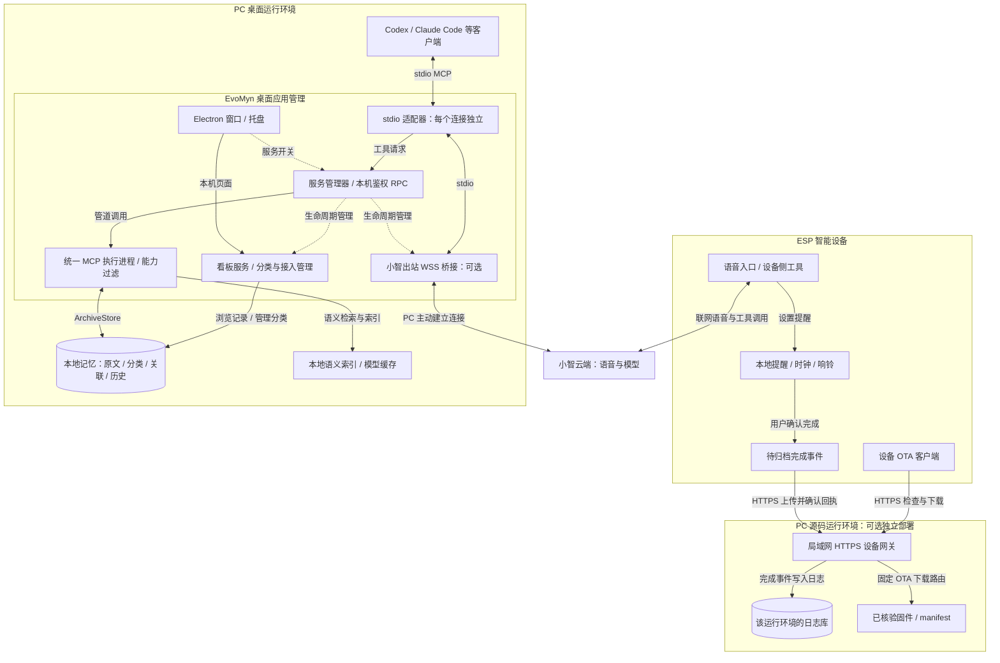
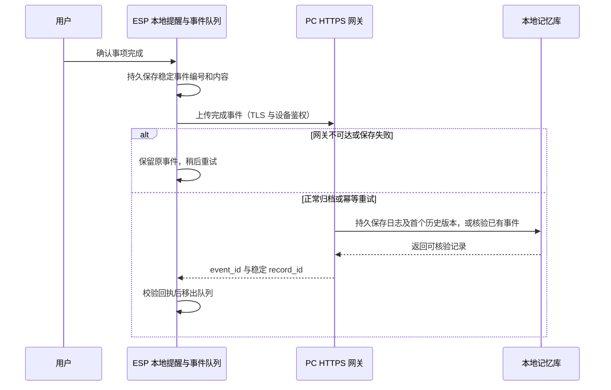

# 架构与数据边界

本文描述当前实现，以 Windows 桌面安装为主要入口；设备完成归档与定制 OTA 目前属于源码后端的可选部署。EvoMyn 负责本地记忆、MCP 工具和设备配套服务；对话模型由接入的 AI 客户端或小智云端提供。设备是可选入口，桌面应用可独立使用。

## 组件与调用关系

实线表示请求或数据流，虚线表示生命周期控制。图中的适配器代表多个独立连接；各本机客户端和小智桥接使用同一个桌面执行进程，服务管理器串行转交工具请求。“同时接入”不等于多个工具在执行进程内并行运行。

### 记忆访问的两条入口

1. **本机客户端**：客户端按导出的配置启动 `desktop/backend/client.py`，通过 stdio 使用 MCP 协议；适配器再经带会话凭证的回环 RPC 将请求交给桌面服务。适配器不能自行启动私有执行进程，因此 MCP 总开关对已连接的客户端也生效。
2. **设备语音**：设备连接小智云端，PC 的可选桥接主动建立出站 WSS 连接，将云端工具请求转给同样的 stdio 适配器。需要 MCP 与小智连接均开启、设备与 PC 均联网；这条路径无需 PC 公网 IP，也不要求设备与 PC 在同一局域网。

两条入口操作同一份本地记忆。共享的是显式保存的记录，客户端完整聊天、模型状态不会自动同步；AI 是否调用工具取决于客户端配置和用户指令。语音访问 PC 记忆没有设备端通用离线缓存。

### 本机服务与网络边界

- 桌面版看板、档案 API、能力管理和 RPC 使用动态分配的 `127.0.0.1` 端口。`desktop-session.json` 保存当前会话地址和凭证，由适配器读取，不是公开 MCP 接入地址。
- 本地客户端导出的是 stdio 配置，不是 HTTP MCP URL。源码启动器的默认看板地址 `http://127.0.0.1:18768/memory/` 不应硬编码为桌面版地址。
- 设备网关是另一个独立的 HTTPS 监听器，必须显式配置局域网地址、证书和设备身份；不经过看板反向代理，不向设备开放管理页面或任意工具执行。
- 小智接入点保存在私有配置中，不进入导出的客户端 TOML / JSON。工具检索返回的记忆会进入所选 AI 服务的处理流程；本地存储不代表云端 AI 无法看到被调用工具返回的内容。

## 服务开关与进程所有权

| 操作 | 本机 MCP / 执行进程 | 小智连接 | 看板 |
| --- | --- | --- | --- |
| 关闭窗口，保留托盘 | 保持当前状态 | 保持当前状态 | 继续运行 |
| 关闭小智连接 | 不受影响 | 停止 | 不受影响 |
| 关闭 MCP 总开关 | 禁止调用并停止执行进程 | 停止实际连接 | 继续运行 |
| 退出桌面应用 | 停止 | 停止 | 停止 |

MCP 开关控制工具执行，看板可继续浏览。独立源码部署的设备网关由其看板进程承载，不受桌面应用开关或退出操作控制。执行进程异常或交换超时会使服务管理器停止该执行实例并关闭 MCP 状态，避免继续使用失效管道。

安装包升级前会停止桌面服务，并确认登记的客户端转发进程已退出；应用重新启动后，AI 客户端需要重新连接。

## 记忆、索引与备份

`ArchiveStore` 将原始档案、历史版本、双向关联和分类保存在 SQLite。原文持久化与语义索引分离：索引失败保留已提交原文及待索引状态，可稍后重试。首次语义检索可能下载本地模型；这些模型用于记忆检索，不是内置聊天模型。

默认分类为人脉、日志、个人、事件、资料。分类使用稳定编号，改名和排序不改写记录或历史；MCP 通过 `archive_status.categories` 获取当前编号和名称。看板支持分类设置，记录正文仍通过 MCP 写入。分类设置 API 要求同源 Origin 与 CSRF 令牌，只读挂载不开放编辑。

能力开关同时限制工具发现与调用，商城只提供已适配目录。世界时间等可选扩展使用独立环境，不改变核心记忆服务的依赖。

桌面版用户数据位于 `%LOCALAPPDATA%/PersonalMemory/service/`：

| 路径 | 内容 |
| --- | --- |
| `state/data/mnemosyne.db` | 记忆原文、分类、关联及历史 |
| `state/resources/` | 附件资源 |
| `state/backups/` | 用户手动创建的数据库快照 |
| `app/.env` | 小智接入点等私有配置 |
| `app/models/` | 本地模型缓存 |
| `logs/` | 运行日志 |

`archive_backup` 创建一致性数据库快照；附件需另行保留，不默认上传云端。更新代码与用户数据分开，应用升级默认保留记录和配置。备份恢复的停机、旧库保留与附件处理见[备份与恢复](../server/personal-memory/BACKUP.md)。

## 设备提醒与完成归档

**当前接入边界**：网关实现位于源码后端，但桌面版还没有接通其配置。`desktop/backend/paths.py` 的配置白名单不转发 `.env` 中的网关参数，`host.py` 在加载看板模块后还原受管环境；因此不能通过填写桌面 `.env` 启动该网关。归档及定制 OTA 目前需使用源码后端配置，不能当作安装包开箱即用的功能。

源码后端默认写入自己的 `state/data/mnemosyne.db`，与桌面版数据库不同。需要归档日志与 AI 检索使用同一份库时，应在同一个源码运行环境中配置网关与 MCP 客户端；并行启动源码后端与桌面应用不会自动合库。桌面网关配置及数据接通仍待实现。

默认 `PLANNER_OWNER=device`。提醒的保存、计时和响铃由 ESP 设备负责，PC 不启动旧计划调度或同步服务，设备内置计划工具也不列入 PC 能力商城。历史 PC 模式代码和数据库表用于兼容旧部署，不代表默认运行方式。

已保存提醒的执行要求设备有电、时钟有效；语音设置仍依赖小智云端。停止响铃或稍后提醒不表示任务完成，只有用户确认完成才产生归档事件。

完成归档走设备到 PC 网关的直接 HTTPS 路径，独立于小智云桥接。网关默认端口为 `18773`，须配置 `DEVICE_GATEWAY_HOST`、TLS 证书与设备 token / ID；设备必须能访问这个局域网地址。

`POST /device/archive` 将完成事件写入 `journal`：保留原始内容及补充说明，不自动生成 AI 总结，也不创建 PC 待办。同一事件编号与相同内容重试返回原记录，不重复写入；同编号不同内容拒绝。语义索引待处理不阻止已持久化原文的成功回执。队列只缓存完成事件，不承担一般语音记忆的离线记录。

完整字段、鉴权与回执规则见[设备完成日志接口](../server/personal-memory/README.md#设备完成日志直传-pc)。

## 桌面更新与设备 OTA

| | Windows 桌面应用 | ESP 固件 |
| --- | --- | --- |
| 更新来源 | GitHub Releases 的 `latest.json` 与版本专属 EXE；可配置有效 HTTPS 源 | 独立源码后端的 PC HTTPS 网关与本地固件目录 |
| 触发方式 | 用户在应用内检查、下载、重启安装 | 设备使用已配置的 OTA 流程检查、下载固件 |
| 校验 | Ed25519 签名、平台、版本、大小与 SHA-256 | HTTPS 设备鉴权、板型、分区、版本、镜像大小与 SHA-256 等 |
| 影响范围 | 更新桌面程序与随包服务代码，默认保留用户数据 | 更新设备固件，不安装或升级 PC 应用 |

桌面更新通过 Electron 网络栈使用 Windows 系统代理与 PAC，逐跳验证 HTTPS 并限制响应大小、重定向及空闲时间。默认源为 `https://github.com/clover-Saber/EvoMyn/releases/latest/download/latest.json`。更新说明的签名与 Windows Authenticode 独立，当前安装包没有 Windows 发布者证书。详见[桌面应用更新](../desktop/README.md#应用内更新)。

设备 OTA 复用独立网关的固定路由 `/updates/manifest` 和 `/updates/firmware/<sha256>.bin`，默认没有可下载内容。发布器先校验应用镜像，再原子发布文件与 manifest；当前流程面向未加密、未签名的应用镜像，不能把它等同于桌面 Ed25519 签名更新。设备烧录、固件发布和小智官方激活分别配置，桌面升级不会自动烧录设备。配置与发布格式见[后端说明](../server/personal-memory/README.md)。

## 源码运行与桌面安装的区别

| | 桌面安装 | 根目录 `Start.cmd` |
| --- | --- | --- |
| 运行目录 | `%LOCALAPPDATA%/PersonalMemory/service/` | 忽略的 `artifacts/local-memory-mcp/` |
| MCP 执行 | 客户端适配器转发到桌面拥有的统一执行进程 | 客户端按需启动独立 stdio 服务，共享源码运行副本的数据库 |
| 生命周期 | 桌面开关、托盘与退出操作管理 | 启动器管理后台；客户端启动的独立进程随客户端管理 |
| 切换方式 | 使用桌面版重新导出的客户端配置 | 使用 `Configure.cmd` 生成的配置 |

两个运行方式使用不同数据目录，不自动迁移或同步。桌面开关不能关闭客户端自行启动的源码 stdio 服务。源码启动器首次组装运行副本，后续复用；拉取 Git 源码不等于更新已有运行环境。维护步骤见[开发指南](development.md)。

## 源码位置与公开边界

| 源码入口 | 职责 |
| --- | --- |
| [desktop/main.cjs](../desktop/main.cjs) · [backend/service.py](../desktop/backend/service.py) | 桌面生命周期、服务管理与总开关 |
| [backend/client.py](../desktop/backend/client.py) · [backend/host.py](../desktop/backend/host.py) | stdio 适配器、执行进程、看板包装与小智桥接 |
| [local/dashboard.py](../server/personal-memory/local/dashboard.py) | 看板、管理入口及可选设备网关的启动 |
| [vendor/](../server/personal-memory/vendor/) · [viewer/](../server/personal-memory/viewer/) | MCP、档案存储、能力包、设备归档与记忆界面 |
| [xiaozhi-firmware/](../xiaozhi-firmware/README.md) | 设备语音、提醒、触屏交互和固件更新 |

维护源码、文档与上游许可公开；运行副本、数据库、附件、模型缓存、凭证、证书私钥、私有设备配置和构建输出不进入源码仓库。`artifacts/` 与 `backups/` 保留本机内容并被 Git 忽略。公开发行通过白名单与候选文件审计组装，不打包当前个人运行目录。
